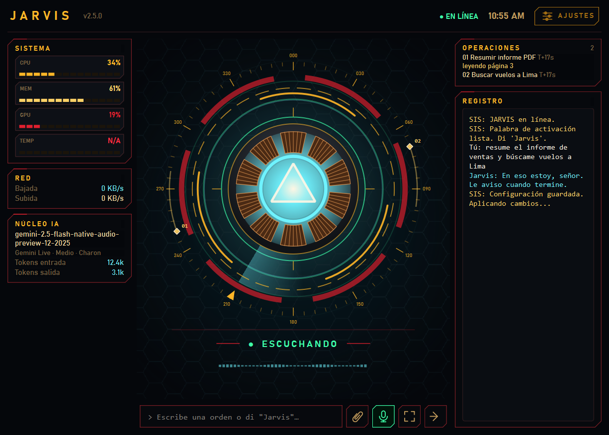
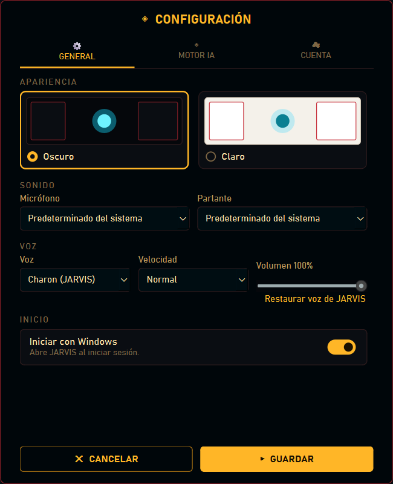
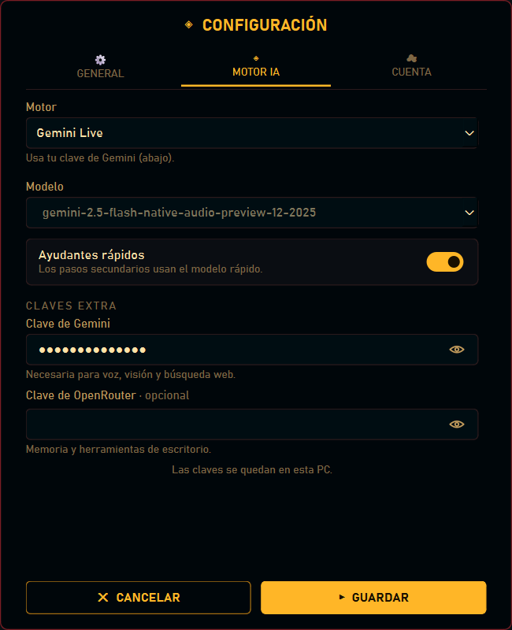
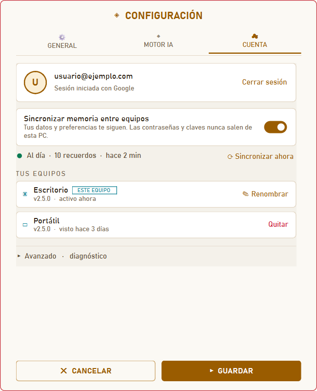
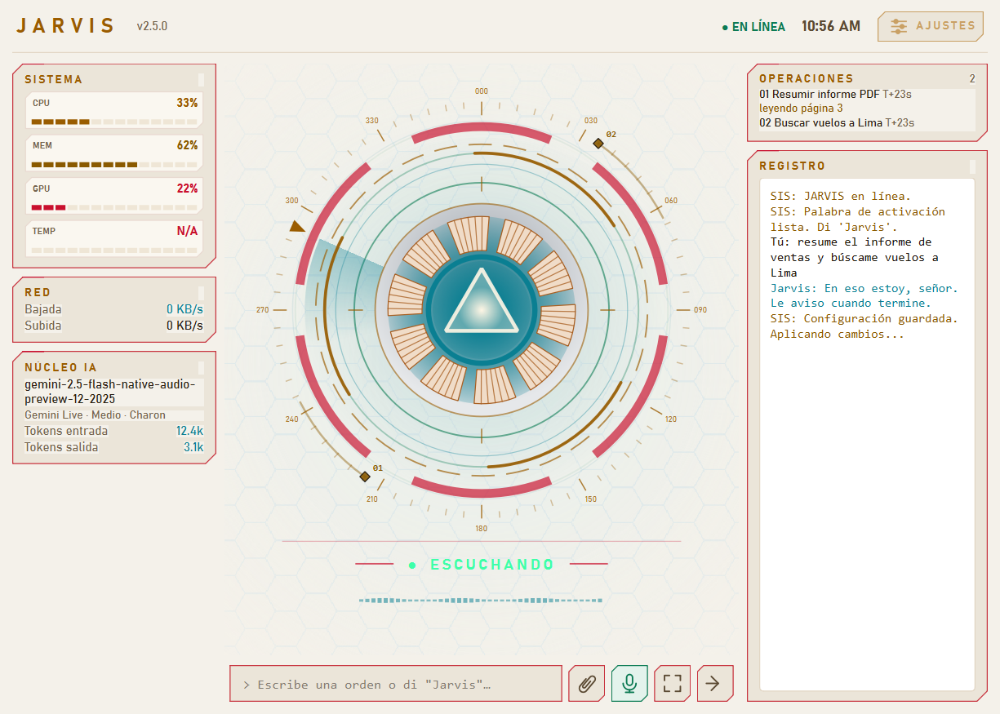

# ATLAS

### Asistente personal de voz con IA para Windows, macOS y Linux

[](https://github.com/pablo29855/Jarvis/releases/latest)
[](https://github.com/pablo29855/Jarvis/actions/workflows/tests.yml)
[](https://creativecommons.org/licenses/by-nc/4.0/)

ATLAS es un asistente que se maneja con la voz o con el teclado. Abre aplicaciones, busca en la web, lee tu correo, trabaja con archivos y resuelve tareas de varios pasos en segundo plano, contándote en todo momento qué está haciendo.

> Basado en **[MARK XXXIX-OR](https://github.com/FatihMakes/Mark-XXXIX-OR)** de **[FatihMakes](https://www.youtube.com/@FatihMakes)**. Ver [Créditos](#créditos).



---

## Descargar

Los instaladores traen todo lo necesario: Python, las librerías, Chromium y el modelo de la palabra de activación.

| Sistema | Archivo | Instalación |
|---|---|---|
| **Windows 10/11** (64 bits) | [Atlas-Setup.exe](https://github.com/pablo29855/Jarvis/releases/latest/download/Jarvis-Setup.exe) | [Guía para Windows](docs/instalacion.md#windows) |
| **macOS** (Apple Silicon) | [Atlas.dmg](https://github.com/pablo29855/Jarvis/releases/latest/download/Jarvis.dmg) | [Guía para macOS](docs/instalacion.md#macos) |
| **Linux** (x64) | [Atlas-linux.tar.gz](https://github.com/pablo29855/Jarvis/releases/latest/download/Jarvis-linux.tar.gz) | [Guía para Linux](docs/instalacion.md#linux) |

Cada versión publica los instaladores que se lograron compilar. Si un enlace no funciona, revisa la lista de archivos en [Releases](https://github.com/pablo29855/Jarvis/releases).

Los instaladores no están firmados, así que Windows y macOS muestran un aviso la primera vez. La [guía de instalación](docs/instalacion.md) explica cómo continuar, cómo actualizar y cómo resolver los problemas más comunes.

---

## Qué hace

- **Conversación por voz en tiempo real.** Te responde en el idioma en que le hablas. También puedes escribirle, incluso mientras está hablando.
- **Palabra de activación sin internet.** Di "Atlas" para despertarlo. La detección corre en tu equipo con [Vosk](https://alphacephei.com/vosk/): el audio no sale mientras está en espera.
- **Varios motores de IA.** Gemini Live (por defecto), Claude (API o suscripción), OpenAI, OpenRouter, Groq, DeepSeek u Ollama en local.
- **Control del equipo.** Abre aplicaciones y maneja ventanas, archivos, volumen, brillo, teclado y ratón.
- **Tareas autónomas.** Un agente ReAct resuelve tareas de varios pasos en segundo plano: decide cada paso viendo el resultado del anterior y corrige el rumbo si algo falla. El panel OPERACIONES muestra cada tarea y el paso en que va.
- **Habilidades aprendidas.** Si no tiene una herramienta para algo, escribe un script, lo prueba y lo guarda solo si funciona. Antes de una acción de riesgo pide confirmación.
- **Visión y archivos.** Analiza tu pantalla, la cámara y los archivos que arrastras a la ventana (PDF, Word, Excel, código, imágenes).
- **Correo.** Lee, busca, redacta y responde en Outlook / Microsoft 365, Gmail o IMAP. Solo envía cuando le dices que sí.
- **Mensajes y música.** Telegram, WhatsApp, YouTube y Apple Music.
- **Luces Bluetooth.** Controla el controlador LED SP621E (BanlanX). Solo confirma un cambio cuando el controlador responde.
- **Memoria y personalidad.** Recuerda tus preferencias entre conversaciones y adapta el tono: pídele "más formal" o "respuestas cortas" y lo mantiene.
- **ATLAS ID (opcional).** Inicia sesión con Google para sincronizar tu memoria entre tus equipos. Las claves de API y las contraseñas nunca se sincronizan. Ver [ATLAS ID](docs/atlas-id-setup.md).
- **Tu voz, tu tema.** Elige voz, velocidad y volumen, y el tema claro u oscuro. Todos los ajustes se aplican al guardar, sin reiniciar.
- **Sabe lo que puede hacer.** Comprueba qué herramientas funcionan en tu equipo antes de prometer algo.

---

## Ajustes

El botón **AJUSTES** (arriba a la derecha) abre los ajustes. La primera vez se abren solos. Tienen tres pestañas:

| Pestaña | Qué contiene |
|---|---|
| **GENERAL** | Tema claro u oscuro, micrófono, parlante, voz (voz, velocidad y volumen) e inicio automático con el sistema. |
| **MOTOR IA** | Motor de IA, sus claves y, en *Avanzado*, el modelo y la URL del servidor. |
| **CUENTA** | ATLAS ID: inicio de sesión, sincronización de memoria y tus dispositivos. |

El tema se aplica en cuanto lo eliges. **GUARDAR** guarda y aplica el resto de cambios al momento, sin reiniciar ATLAS.

| General | Motor IA | Cuenta (tema claro) |
|---|---|---|
|  |  |  |

### Motores y claves

| Motor | Qué necesitas |
|---|---|
| **Gemini Live** (por defecto) | Una clave gratuita de [Google AI Studio](https://aistudio.google.com/apikey). Voz nativa. |
| **Claude (suscripción)** | Tu cuenta de Claude Pro o Max. Inicia sesión con *INICIAR SESIÓN CON CLAUDE*. |
| **Claude, OpenAI, Groq, DeepSeek, OpenRouter** | La clave de API del servicio. |
| **Ollama** | [Ollama](https://ollama.com) en tu equipo. Sin claves. |

Con un motor distinto de Gemini Live, la voz se reconoce con OpenAI `gpt-4o-mini-transcribe` (si pusiste una clave de OpenAI) o con Google STT gratuito, y se habla con la voz de Gemini o con Edge TTS. Visión, búsqueda web y memoria usan las claves de Gemini y OpenRouter.

Las claves se guardan solo en tu equipo, en `config/api_keys.json`.

<details>
<summary><b>Configurar correo</b></summary>

Añade tus cuentas a `config/api_keys.json`:

```json
"email_accounts": [
  {"name": "trabajo", "type": "graph", "client_id": "<id de la app en Entra ID>", "tenant": "organizations"},
  {"name": "personal", "type": "imap", "address": "yo@gmail.com", "password": "<contraseña de aplicación>"}
]
```

- `graph`: Microsoft 365 u Outlook.com (usa `"tenant": "consumers"` para cuentas personales). Registra una app de cliente público en Entra ID con los permisos delegados `Mail.ReadWrite` y `Mail.Send`. La primera vez muestra un código para microsoft.com/devicelogin.
- `imap`: Gmail, Yahoo, iCloud o cualquier servidor con `imap`, `smtp` y `smtp_port`. Gmail necesita una contraseña de aplicación.

Detalles en `actions/email_client.py`.
</details>

<details>
<summary><b>Palabra de activación</b></summary>

En `config/api_keys.json`:

```json
"wake_word": "auto"
```

- `auto`: se activa si Vosk y el modelo están instalados (los instaladores los incluyen).
- `true`: siempre activa.
- `false`: escucha todo el tiempo, sin palabra de activación.

El botón del micrófono (o **F4**) silencia el micrófono. También puedes pedírselo a ATLAS.
</details>



---

## Ejecutar desde el código

Necesitas Python 3.11. Se recomienda [uv](https://docs.astral.sh/uv/).

```bash
git clone https://github.com/pablo29855/Jarvis.git
cd Jarvis
uv venv -p 3.11 .venv
uv pip install -p .venv -r requirements.txt
.venv/bin/python -m playwright install chromium   # Windows: .venv\Scripts\python.exe
.venv/bin/python main.py
```

En Linux instala antes `libportaudio2` y `libxcb-cursor0` (ver la [guía de Linux](docs/instalacion.md#linux)).

Tests (sin red, sin micrófono y sin claves):

```bash
python -m unittest discover tests
```

### Construir los instaladores

```bash
.venv/bin/python installer/build.py
```

Construye el instalador del sistema en que se ejecuta y lo deja en `dist/`. En Windows necesita [Inno Setup 6](https://jrsoftware.org/isinfo.php). La versión se lee de `config/__init__.py`.

**Publicar una versión:** sube un tag `vX.Y.Z` (por ejemplo `git tag v2.5.0 && git push origin v2.5.0`). La GitHub Action [Build installers](.github/workflows/build.yml) construye los tres instaladores y los publica en Releases con las notas de `.github/release-notes.md`.

### Estructura

| Carpeta | Contenido |
|---|---|
| `main.py`, `engines.py` | Bucle de voz, motores y herramientas |
| `ui.py` | Interfaz, HUD y ajustes |
| `agent/` | Agente ReAct, cola de tareas en segundo plano y auto-mejora |
| `actions/` | Herramientas: apps, archivos, web, correo, mensajes, música… |
| `memory/` | Memoria, ATLAS ID, sincronización y habilidades aprendidas (`builtin_skills/` viene incluido) |
| `supabase/` | Migraciones de la base de datos de ATLAS ID |
| `wakeword.py` | Palabra de activación local |
| `voice.py` | Voces, velocidad y volumen de ATLAS |
| `updater.py` | Copias de seguridad y aviso de versiones nuevas |
| `installer/` | Construcción de instaladores |
| `docs/` | Guías e informes |
| `tests/` | Tests |

---

## Requisitos

| | |
|---|---|
| **Sistema** | Windows 10/11 de 64 bits, macOS en Apple Silicon o Linux x64 |
| **Micrófono** | Para hablarle. Por texto funciona sin él. |
| **Claves** | Al menos una: Gemini (gratuita) o la del motor que elijas |
| **Espacio** | Unos 2 GB instalado |
| **Internet** | Necesario para los motores en la nube. Ollama funciona en local. |
| **Bluetooth** | Opcional, para las luces LED (Bluetooth LE) |

---

## Créditos

Este proyecto parte de **[MARK XXXIX-OR](https://github.com/FatihMakes/Mark-XXXIX-OR)**, creado por **FatihMakes**. La base de ATLAS, su interfaz, el bucle de voz con Gemini Live y las herramientas originales son su trabajo. El historial de commits original se conserva en este repositorio.

| Plataforma | Enlace |
|---|---|
| YouTube | [@FatihMakes](https://www.youtube.com/@FatihMakes) |
| Instagram | [@fatihmakes](https://www.instagram.com/fatihmakes) |
| Video de la versión original | [Ver en YouTube](https://youtu.be/ldvDNzwnM8k) |

Mejoras de esta versión por **[Pablo Romero](https://github.com/pablo29855)**: motores Claude y multimotor, palabra de activación local, tareas en segundo plano, habilidades aprendidas, correo, ATLAS ID, ajustes con tema claro y oscuro, instaladores para cada sistema y actualizador.

El protocolo de las luces SP621E proviene de [UniLED](https://github.com/monty68/uniled) (MIT).

La cabeza holográfica del HUD es el modelo ligero de [ICT-FaceKit](https://github.com/USC-ICT/ICT-FaceKit) (USC Institute for Creative Technologies, MIT; ver `qml/face-LICENSE.txt`), convertido con `tools/make_face.py`. Los continentes del globo vienen de [Natural Earth](https://www.naturalearthdata.com/) (dominio público).

---

## Licencia

Uso personal y no comercial. Igual que el proyecto original, se distribuye bajo **[Creative Commons BY-NC 4.0](https://creativecommons.org/licenses/by-nc/4.0/)**: puedes compartirlo y modificarlo dando crédito, pero no usarlo con fines comerciales.
